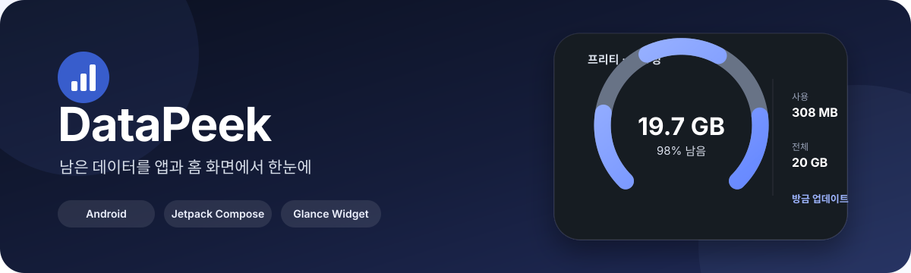
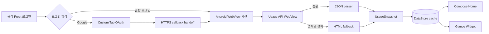

<div align="center">
  

  <br />

  [](#요구-환경)
  [](#기술-스택)
  [](#기술-스택)
  [](#홈-화면-위젯)
  [](#검증)

  **통신사 데이터 사용량을 안전하게 확인하고, 반응형 홈 화면 위젯으로 바로 보여주는 Android 앱**

  [주요 기능](#주요-기능) · [위젯](#홈-화면-위젯) · [작동 방식](#작동-방식) · [빌드](#빌드) · [보안](#보안과-개인정보)
</div>

---

## DataPeek이란?

DataPeek은 프리티 SKT망의 실제 사용량을 확인해 **남은 데이터, 사용량, 전체 제공량**을 앱과 Android 홈 화면 위젯에 표시합니다. 공식 로그인 흐름과 Android WebView의 세션을 그대로 사용하며, 마지막으로 정상 조회한 데이터는 갱신 실패 시에도 안전하게 유지합니다.

> 빠르게 보는 것은 위젯에서, 자세히 확인하고 갱신하는 것은 앱에서.

## 주요 기능

| | 기능 | 설명 |
|---|---|---|
| 📊 | **실제 사용량 조회** | 프리티 사용량 API를 우선 사용하고 HTML 경로를 fallback으로 지원합니다. |
| 🧩 | **반응형 위젯** | 실제 launcher dp 크기에 맞춰 INFO와 GAUGE 레이아웃의 정보 밀도를 조절합니다. |
| 🎨 | **위젯별 디자인** | 각 위젯마다 스타일, 전경색, 배경, 투명도, 새로고침 표시를 설정할 수 있습니다. |
| 🔐 | **공식 로그인 흐름** | 일반 로그인은 WebView, Google OAuth는 Custom Tab과 HTTPS callback handoff를 사용합니다. |
| 🔄 | **안전한 갱신** | API 조회가 실패해도 마지막 정상 snapshot을 지우지 않습니다. |
| 📈 | **데이터 소진 예측** | 조회 이력을 앱에 저장하고 최근 소비 속도로 소진 예상일과 하루 권장량을 계산합니다. |
| 🛡️ | **민감정보 최소화** | 비밀번호·Cookie·Authorization·OAuth code를 출력하거나 별도 HTTP client로 복사하지 않습니다. |

## 홈 화면 위젯

앱 화면은 [Samsung One UI 디자인 가이드](https://developer.samsung.com/one-ui/overview.html)를 참고해 구성합니다. 큰 제목은 스크롤하면 접히고, 주요 동작은 하단에서 실행합니다. 홈·소진 예측·설정·개발자 옵션·위젯 설정에 공통 테마를 적용하며 시스템 다크 모드와 글자 크기를 따릅니다. 디자인 기준은 [DESIGN.md](DESIGN.md)에 기록합니다.

DataPeek 위젯은 작은 크기에서는 핵심 숫자에 집중하고, 공간이 커질수록 사용량·전체량·잔여율·업데이트 상태를 단계적으로 추가합니다.

| 항목 | 지원 내용 |
|---|---|
| 스타일 | `INFO`, `GAUGE` |
| 크기 | Launcher가 제공하는 실제 dp 기준 반응형 레이아웃 |
| 형태 | 가로형 dashboard, 세로형 stack, 균형형 detail |
| 게이지 | 아래가 열린 원형 링, round cap, 잔여 데이터 비율 표시 |
| 전경 | 시스템, 밝은 글자, 어두운 글자 |
| 배경 | 사용 여부와 0–100% 투명도 |
| 인스턴스 | `appWidgetId`별 독립 설정 |
| 동작 | 앱 열기, 수동 새로고침, 마지막 업데이트 표시 |

### 크기에 따른 정보 밀도

```text
아주 작음      남은 데이터
가로형        남음 │ 사용 │ 전체 │ 업데이트
세로형        남음
              사용
              전체
중·대형       Gauge + 잔여율 + 상세 metric + 상태
```

숫자와 단위는 좁은 공간에서 `19.7G`, `308M`, `20G`처럼 compact하게 표시해 의도치 않은 줄바꿈을 방지합니다.

## 지원 현황

| 통신사 | 상태 | 범위 |
|---|---|---|
| **프리티 · SKT망** | 사용 가능 | 공식 로그인, Google OAuth, 사용량 API, HTML fallback, 위젯 연동 |
| **SK텔레콤 T world** | 기반 구조 | Provider와 공식 로그인 진입 구조 |

기기 `NetworkStatsManager` 기반 추정치는 사용하지 않습니다. 표시 값은 통신사 서버에서 조회한 snapshot을 기준으로 합니다.

### 데이터 소진 예측

- 실제 통신사 사용량 조회에 성공할 때마다 잔여량과 조회 시각을 기기에 저장합니다. 앱을 다시 실행해도 기록이 유지됩니다.
- 최근 최대 7일의 잔여량 감소분을 실제 경과 시간으로 나눠 하루 평균 사용량을 계산합니다. 최소 24시간 간격의 기록이 있어야 예측을 시작합니다.
- 홈 화면에서 소진 예상일을 확인할 수 있습니다. 초기화일 정보가 있으면 그 전에 소진되는지와 초기화일까지의 하루 권장량도 표시합니다. 초기화일을 모르면 이를 가정하지 않습니다.
- 데이터 충전, 제공량·회선·사용 기간 변경, 7일 초과 조회 공백에는 기록을 새로 시작합니다. 하루 넘게 오래된 기록이나 이미 끝난 기간에는 새로고침을 안내합니다.
- 테스트 데이터와 실패한 조회는 예측 기록에 포함하지 않습니다. 로그아웃 또는 캐시 삭제 시 이력도 삭제합니다. 기록에는 사용량·시각·기간과 회선 구분용 해시만 저장합니다.
- 예측은 마지막 정상 조회 시점의 사용 패턴을 연장한 추정치입니다. 통신사 반영 시차나 이후 사용 패턴에 따라 달라질 수 있으며, 앱이 닫힌 동안 기기 트래픽을 직접 측정하지 않습니다.

## 작동 방식



- API endpoint: `GET https://api.freet.co.kr/mypage/usage`
- HTML fallback: `GET https://www.freet.co.kr/mypage/usage`
- 실제 조회는 로그인 WebView와 같은 Android WebView Cookie store를 사용합니다.
- WorkManager는 background에서 headless WebView를 실행하지 않고 갱신 필요 상태를 기록합니다.

## 기술 스택

| 영역 | 기술 |
|---|---|
| 언어 | Kotlin 2.2.20, JVM 17 |
| 앱 UI | Jetpack Compose, Material 3 |
| 위젯 | Jetpack Glance AppWidget |
| 로컬 상태 | Preferences DataStore |
| 작업 예약 | WorkManager |
| 인증 | Android WebView, AndroidX Browser Custom Tabs |
| 파싱 | `org.json`, jsoup |
| 테스트 | JUnit 4, Kotlin Test |
| CI | GitHub Actions — test, lint, assembleDebug |

## 프로젝트 구조

```text
app/src/main/java/com/datapeek/
├── data/
│   ├── model/          # UsageSnapshot과 공통 모델
│   ├── provider/       # 통신사 Provider와 Freet parser
│   ├── repository/     # snapshot·오류·설정 저장
│   └── session/        # Keystore 기반 세션 표식
├── ui/                 # Compose 화면과 로그인 흐름
├── widget/             # Glance 위젯, 반응형 정책, 인스턴스별 설정
└── worker/             # WorkManager 예약과 foreground 갱신 신호
```

## 요구 환경

- Android Studio 또는 Android SDK command-line tools
- JDK 17
- Android SDK 36
- Android 8.0 / API 26 이상 기기 또는 emulator

`local.properties`에 로컬 Android SDK 경로를 설정합니다. 이 파일은 Git에 추가하지 않습니다.

## 빌드

Windows PowerShell:

```powershell
./gradlew.bat test
./gradlew.bat lint
./gradlew.bat assembleDebug
```

macOS / Linux:

```bash
./gradlew test
./gradlew lint
./gradlew assembleDebug
```

생성된 APK:

```text
app/build/outputs/apk/debug/app-debug.apk
```

연결된 Android 기기에 설치하려면:

```bash
adb install -r app/build/outputs/apk/debug/app-debug.apk
```

## 검증

GitHub Actions는 push와 pull request마다 다음 작업을 실행합니다.

1. 전체 단위 테스트
2. Android lint
3. Debug APK 조립

테스트 범위에는 formatter, percent clamp, reset D-day, Home·Widget 상태, 반응형 Widget geometry, Freet JSON/HTML parser, OAuth callback handoff, 민감정보 비노출 진단이 포함됩니다.

실제 통신사 로그인 세션, launcher별 resize 결과와 Galaxy One UI 위젯 표시는 Android 실기기에서 별도로 검증해야 합니다.

## 보안과 개인정보

- 로그인 비밀번호를 앱 `TextField`나 저장소에 보관하지 않습니다.
- WebView Cookie를 읽어 출력하거나 OkHttp 등 다른 client에 주입하지 않습니다.
- 세션 표식은 Android Keystore의 AES-GCM으로 보호하고 Android backup에서 제외합니다.
- OAuth `state`, `code`, Cookie, Authorization header와 전화번호를 진단 로그에 남기지 않습니다.
- SSL 우회, user-agent 위장, Chrome Cookie 추출을 사용하지 않습니다.
- 갱신 실패 시 마지막 정상 데이터는 유지하되 오류 상태를 함께 표시합니다.

<details>
<summary><strong>Freet API 및 로그인 구현 상세 보기</strong></summary>

### 사용량 조회

로그인 직후와 foreground 갱신은 전용 API WebView 경로를 우선 사용합니다. 전용 WebView는 `https://api.freet.co.kr/mypage/usage`를 top-level navigation으로 열고, `onPageFinished` 이후 `document.body.innerText`만 읽어 JSON parser에 전달합니다.

응답·body·transport가 명확히 실패하면 새 HTML WebView로 전환해 `https://www.freet.co.kr/mypage/usage`의 기존 HTML parser를 실행합니다. 전용 WebView는 화면에 표시하지 않는 1dp 영역에 attach되며 처리 후 `stopLoading`, `clearHistory`, `destroy`로 정리됩니다.

### Google 로그인

관찰된 authorization 경로는 `accounts.google.com/o/oauth2/v2/auth`입니다. 앱은 해당 URL을 Custom Tab에 전달하고, 인증 완료 후 `https://www.freet.co.kr/oauth/google` callback을 DataPeek Activity에서 받아 기존 Freet WebView로 handoff합니다.

사용자 제공 Galaxy 결과에서는 Custom Tab 로그인, callback 수신, WebView handoff, Freet session 생성, API 사용량 조회와 Home 표시까지 성공했습니다. 일반 프리티 아이디 로그인과 공식 도메인 navigation도 계속 지원합니다.

### 익명화된 parser fixture

실제 페이지에서 관찰한 `MVNO Data 20GB 공제 (LTE)`, `20G`, `19.02G`, `999.81M`, `잔여일 : 2일` 구조는 개인정보를 제거한 fixture로 parser 테스트에 사용합니다. `Copy as cURL` 진단은 공식 경로와 method만 요약하며 Cookie, Authorization, token, body를 저장하지 않습니다.

</details>

## 현재 제약

- WorkManager의 주기는 Android 정책상 정확한 시각 실행을 보장하지 않습니다.
- 앱이 열리지 않은 상태의 실제 Freet WebView 서버 갱신은 Galaxy E2E 검증이 추가로 필요합니다.
- Galaxy One UI를 우선 검증 대상으로 삼지만 Samsung 전용 API에는 의존하지 않습니다.

---

<div align="center">
  <strong>DataPeek</strong><br />
  필요한 데이터만, 필요한 순간에.
</div>
